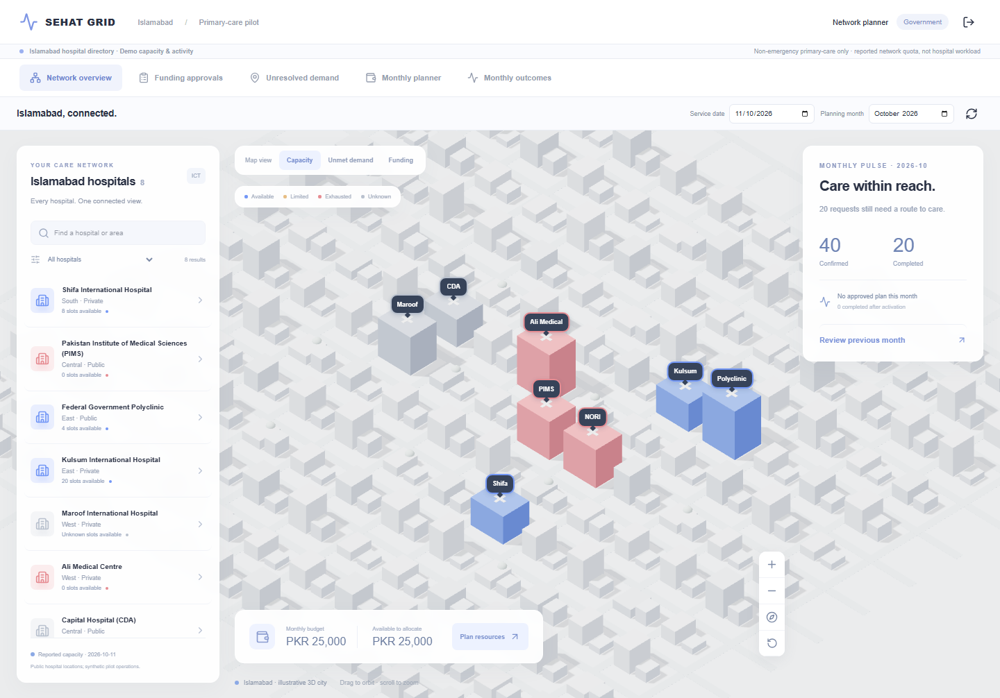

# SEHAT GRID

SEHAT GRID coordinates non-emergency primary care across eight Islamabad hospitals and five pilot catchments. It combines hospital staff workflows, AI-assisted request guidance, and solver-checked funding and capacity plans. Hospital directory context is public; requests, partnerships, quotas, costs and care records are synthetic.

## Demo

Open [SEHAT GRID](https://sehat-grid.vercel.app). Use **Demo access** to copy or autofill a role account; the shared demo password is `demo`. Start with the in-app guide or [five-minute demo](docs/guides/demo.md).

| Role | Demo username |
|---|---|
| Government planner | `planner` |
| Public reception | `operator-nori` |
| Hospital reception | `operator-shifa-international`, `operator-pims` |
| Hospital onboarding | `onboarder-polyclinic` |

Other hospital accounts use the hospital slug after `operator-` or `onboarder-`. Legacy `p01`–`p08` aliases remain available.

## Product workflow

1. Hospital staff maintain reviewed eligibility, service catalog and dated quota.
2. Public reception reviews an AI-suggested service match, registers a synthetic request and checks eligible destinations.
3. Reception proposes and reserves a referral. The receiver accepts; staff records patient agreement, funding approval when required, arrival and completion.
4. Government can ask AI to turn blocked demand into a structured funding/capacity scenario. The allocation solver checks eligibility, dates, budget and capacity, then compares coverage and cost with the standard plan.
5. Government reviews, revises and approves the draft. Responsible hospitals activate any new resources; reception records subsequent care.

AI contributes MiniLM semantic matching and Groq-hosted Qwen advice for reception, onboarding and government planning. Advice cannot change records or approve spending. Deterministic backend rules and the OR-Tools solver validate decisions; staff remain responsible for actions. WhatsApp updates are preview-only and are not sent.



The government map shows capacity, demand and funding. Green indicates available quota, amber limited, red exhausted, grey unknown/inactive. Map controls and selected layer persist across views. No map token or external tiles are needed.

## Run locally

Requirements: Python 3.12, Node 22+. From the repository root in PowerShell:

```powershell
python -m venv .venv
.venv/Scripts/python.exe -m pip install -r backend/requirements-dev.txt
Copy-Item backend/.env.example backend/.env
# Set JWT_SECRET (at least 32 characters) and DEMO_PASSWORD in backend/.env.
# Optional AI: set AI_API_KEY and AI_MODEL (default qwen/qwen3.8-27b).
.venv/Scripts/python.exe backend/scripts/preload_model.py
cd backend
../.venv/Scripts/python.exe -m alembic upgrade head
../.venv/Scripts/python.exe scripts/seed_demo.py
../.venv/Scripts/python.exe -m uvicorn app.main:app --host 127.0.0.1 --port 8000
```

In another terminal:

```powershell
cd frontend
npm ci
npm run dev
```

Open `http://localhost:3000`. Next.js proxies `/api/v1` to FastAPI. For a local production frontend, run `npm run build` then `npm start`. The backend supports SQLite for local demos and PostgreSQL for shared persistence.

A deliberate local demo reset (run from `backend/`) is `../.venv/Scripts/python.exe scripts/seed_demo.py --reset`. It replaces synthetic pilot state. A fresh seed includes 20 completed, 20 confirmed and 20 unresolved requests. The standard plan has a PKR 25,000 budget and projects up to 20 additional accommodations; these are synthetic estimates.

## Deployment configuration

The frontend is configured for Vercel and the backend for a Docker Space on Hugging Face. See [deployment instructions](docs/guides/deployment.md) for build roots, proxy settings, Space port, model artifacts and secrets. The README records configuration, not current deployment status.

## Documentation

- [Documentation index](docs/README.md)
- [System architecture](docs/architecture/overview.md) and [UML diagrams](docs/architecture/diagrams.md)
- [API contracts](docs/reference/api-contracts.md), [AI contracts](docs/reference/ai-contracts.md), and [role permissions](docs/reference/role-portals.md)
- [Routing and patient updates](docs/reference/routing-and-patient-updates.md)
- [Manual testing](docs/guides/testing.md) and [browser acceptance](docs/guides/browser-acceptance.md)
- [Operational assumptions](docs/reference/assumptions.md), [product scope](docs/reference/product-scope.md), and [hospital directory attribution](docs/reference/islamabad-directory.md)

This is not a patient portal or clinical decision system. It does not diagnose, triage emergencies, book exact time slots, send WhatsApp messages or process payments. Real clinical use needs separate governance and operational validation.
