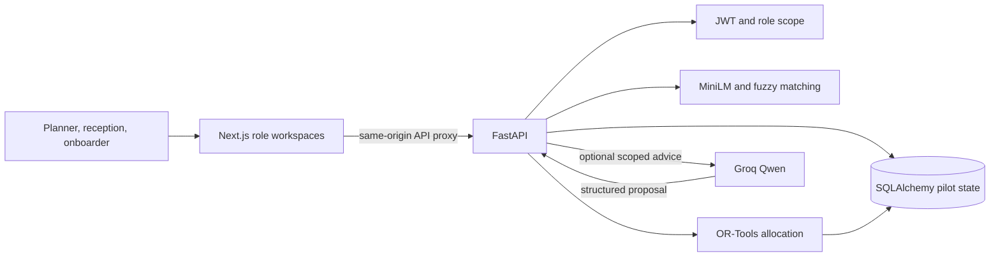
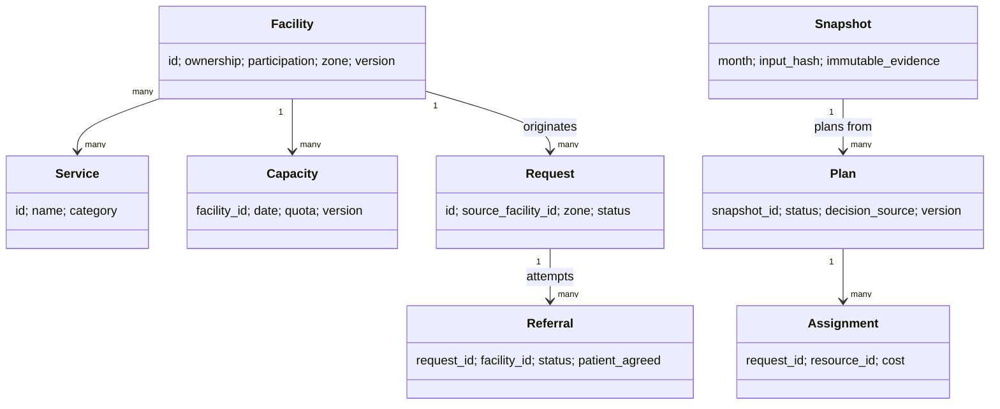
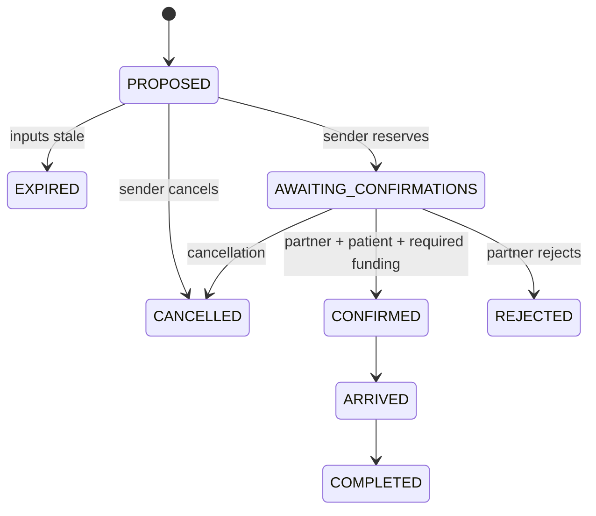
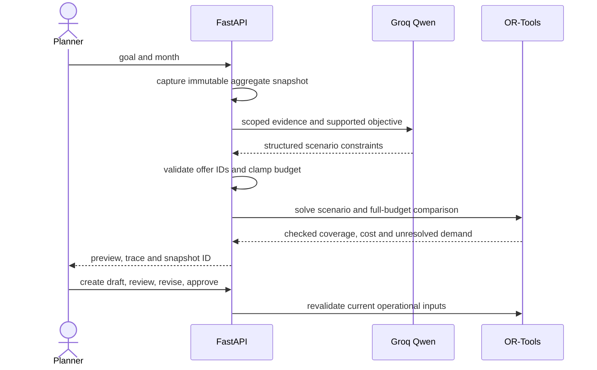

# SEHAT GRID architecture diagrams

The diagrams use Mermaid and render in GitHub Markdown.

## Components

## Core domain relationships

## Referral lifecycle

## AI allocation sequence

See [AI contracts](../reference/ai-contracts.md), [API contracts](../reference/api-contracts.md), and [operational assumptions](../reference/assumptions.md).
