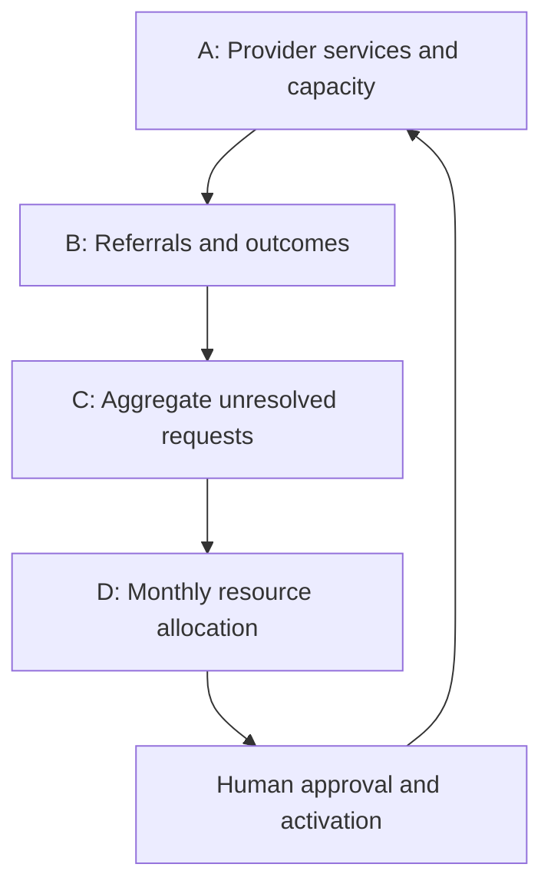

# SEHAT GRID

## Healthcare Access Coordination and Monthly Resource Allocation

> Connect available care. Coordinate referrals. Reveal unmet network demand. Allocate limited resources.

**SEHAT GRID** is an AI-assisted healthcare coordination platform for selected Islamabad pilot zones. It connects participating public and private providers, helps authorized operators coordinate eligible non-emergency primary-care referrals, and recommends how a fixed monthly budget could support subsidies, purchased partner service quotas, and mobile clinics.

The platform combines **machine learning to understand inconsistent records and service descriptions** with **mathematical optimization to make feasible capacity and budget decisions**.

**Document status:** Agreed product scope and proposed implementation specification. This README describes the system to build; it does not establish that the software, integrations, partner agreements, or evaluated benefits already exist.

**Scope version:** 1.0 · **Prepared:** 10 October 2026 · **Working team:** ZenoSquad, three developers

---

## Contents

1. [Vision and problem](#1-vision-and-problem)
2. [Agreed MVP boundary](#2-agreed-mvp-boundary)
3. [How the complete system works](#3-how-the-complete-system-works)
4. [Users and permissions](#4-users-and-permissions)
5. [Module A — Hospital Network](#5-module-a--hospital-network)
6. [Module B — Referral Coordination](#6-module-b--referral-coordination)
7. [Module C — Healthcare Intelligence](#7-module-c--healthcare-intelligence)
8. [Module D — Resource Allocation Engine](#8-module-d--resource-allocation-engine)
9. [Machine learning and optimization](#9-machine-learning-and-optimization)
10. [Capacity, referral, and financial rules](#10-capacity-referral-and-financial-rules)
11. [Data model and contracts](#11-data-model-and-contracts)
12. [Technical architecture](#12-technical-architecture)
13. [Proposed API](#13-proposed-api)
14. [Frontend screens](#14-frontend-screens)
15. [Data and demonstration setup](#15-data-and-demonstration-setup)
16. [Implementation and local development](#16-implementation-and-local-development)
17. [Testing and evaluation](#17-testing-and-evaluation)
18. [Five-minute end-to-end demonstration](#18-five-minute-end-to-end-demonstration)
19. [Delivery plan and team responsibilities](#19-delivery-plan-and-team-responsibilities)
20. [Definition of done](#20-definition-of-done)
21. [Limitations and expansion path](#21-limitations-and-expansion-path)
22. [Project pitch](#22-project-pitch)

---

## 1. Vision and problem

### Vision

Make healthcare easier to access by connecting existing providers into a shared service network, coordinating their reported capacity, and using unresolved requests to guide the next allocation of resources.

### The problem this project addresses

Participating providers may have uneven service availability. One facility can exhaust its referral capacity while another has capacity for the same service. Operators need a consistent way to see that availability, obtain a receiving provider's confirmation, and track whether the referral is completed.

Capacity alone is insufficient. An eligible available service may still be financially inaccessible to a request, and some zones may have no suitable participating provider. Planners need to distinguish these problems before deciding whether to fund a subsidy, reserve additional partner quota, or deploy a mobile clinic.

### Product objective

Coordinate eligible requests using existing reported network capacity, then maximize the number of additional eligible request units that can be accommodated within a fixed monthly resource budget.

### What makes the project coherent

Every module contributes to one operational loop:

- **Module A supplies the provider and capacity records.**
- **Module B uses those records to coordinate and track referrals.**
- **Module C aggregates unresolved requests and exhausted capacity.**
- **Module D uses that snapshot to recommend affordable interventions.**

Approved interventions return to Module A as pending or activated service commitments. Module B can then process eligible unresolved requests against the resulting capacity or funding. The planner's recommendation becomes useful only through this connection.

### Positioning

SEHAT GRID is a **healthcare access coordination and monthly resource-allocation system**. The MVP demonstrates a participating network in selected Islamabad zones. Its geography is pilot geography; its operational evidence comes from records actually entered into the platform.

---

## 2. Agreed MVP boundary

| Dimension | Agreed MVP scope |
|---|---|
| Geography | Selected Islamabad pilot zones |
| Service | Non-emergency general primary-care outpatient requests |
| Facilities | 5–10 simulated or clearly identified demonstration partners |
| Users | Hospital operator and network planner |
| ML | Semantic facility-record and service-description matching, with human review |
| Referral decision logic | Eligibility filtering, capacity-based recommendation, approval, and reservation |
| Planning decision logic | Monthly budget-constrained resource allocation |
| Interventions | Service subsidy, purchased partner service quota, mobile clinic |
| Primary outcomes | Referral completion and additional modeled demand accommodated |
| Capacity source | Manual provider updates, with freshness and reservation controls |
| Map intelligence | Partner coverage, exhausted capacity, and aggregate unresolved network requests |
| Demo data | Synthetic requests, capacities, intervention costs, and partner agreements |

### Included features

| Area | Included |
|---|---|
| Provider network | Registration, activation, public/private directory, services, locations, dashboard |
| Capacity | Service-specific daily referral quota, update timestamp, reservations, completion consumption |
| Referrals | Request queue, semantic service suggestions, eligible provider recommendations, approvals, partner response, completion tracking |
| Intelligence | Map of participating facilities, exhausted quotas, and aggregate unresolved requests with reasons |
| Planning | Monthly budget, fixed subsidy costs, offered partner quotas, candidate mobile-clinic sites, computed recommendation |
| Accountability | Role permissions, human review, status history, budget ledger, audit trail, demo-data labels |
| Output | Downloadable plan/result summary containing assumptions, inputs, allocations, and limitations |

### Explicitly outside this MVP

- Regional service-demand patterns, historical trend analysis, seasonal analysis, and demand forecasting.
- Population-density heatmaps and population-based estimates of all unmet healthcare need.
- Road-network routing and travel-time prediction.
- Hospital waiting-time estimation and exact appointment-slot scheduling.
- Whole-hospital walk-in queue or inpatient bed management.
- Probabilistic capacity modeling, automated facility-information verification, and AI verification prioritization.
- Conflicting-source evidence analysis beyond preserving ambiguous matching candidates for review.
- Staffing expansion, facility construction, and capital-investment simulation.
- Voucher issuance, treatment tariff administration, billing, reimbursement processing, or real payments.
- Interactive scenario-comparison laboratory or extensive scientific benchmarking dashboard.
- Diagnosis, clinical triage, treatment recommendation, or automatic clinical eligibility decisions.

**Queue definition:** The platform queue contains referral/service requests registered in SEHAT GRID. It does not represent every patient physically waiting at a hospital.

**Planning definition:** The budget is a monthly service-resource budget. It is not a construction budget or a nationwide infrastructure-investment model.

---

## 3. How the complete system works



### Step 1 — Establish the participating network

An operator registers a demonstration provider, its pilot zone, location, supported services, and daily referral quota. A planner activates participation after reviewing the operational scope. Public directory inclusion alone does not establish partnership.

### Step 2 — Normalize records and services

The ML matcher proposes whether an imported record corresponds to an existing provider and whether a service description corresponds to a supported canonical category. The operator confirms, corrects, or declines the suggestion.

### Step 3 — Register a service request

The operator records a synthetic request ID, pilot zone, requested service, eligible service date or range, and relevant operational eligibility flags. The request must fall within the declared non-emergency primary-care scope.

### Step 4 — Find feasible referral destinations

The system filters facilities by participation, reviewed service category, declared zone eligibility, fresh capacity, and funding requirements. It ranks feasible options using transparent rules and explains the result.

### Step 5 — Review, reserve, and obtain confirmation

An authorized operator selects an option. The backend rechecks capacity and atomically creates a temporary hold. The receiving partner accepts or rejects the request within a configured response period. Confirmation requires receiving-partner acceptance, recorded patient agreement, and funding authorization where applicable.

### Step 6 — Track the outcome

The receiving operator records arrival and service completion. Cancellation, expiry, partner rejection, and inability to find an eligible destination are also recorded. Capacity and financial commitments change according to the status rules.

### Step 7 — Build a current intelligence snapshot

The system aggregates unique unresolved request units by pilot zone and unresolved reason, alongside partner locations and exhausted referral quotas. This is a snapshot of **recorded unmet network demand**, not an estimate of all healthcare need in Islamabad.

### Step 8 — Compute a monthly resource plan

The planner selects the calendar month and enters a synthetic budget. The optimizer uses eligible unresolved demand, dated provider offers, and predeclared mobile sites to recommend subsidy commitments, additional partner quotas, or mobile-clinic deployments.

### Step 9 — Approve and activate resources

The planner approves a versioned plan. Partner quota and mobile-clinic actions remain pending until an operator confirms the offered resources. Activation updates capacity or funding availability. It does not automatically mark requests completed.

### Step 10 — Reprocess and report

Eligible unresolved requests are re-evaluated against the activated resources. The portal separately reports projected additional accommodation, actual confirmed referrals, and actual completed referrals.

---

## 4. Users and permissions

The MVP has two application roles. A hospital operator can act for a sending provider, a receiving provider, or both, within their assigned facility permissions.

| Action | Hospital operator | Network planner |
|---|---|---|
| Maintain own facility profile and services | Yes | Review/activate participation |
| Update own service capacity | Yes | View; request correction |
| Register scoped requests | Yes | View authorized network summaries |
| Review ML suggestions | Yes, for own records | Yes, for network record merges |
| Select a referral destination | Yes, for own requests | Authorized coordination oversight |
| Accept/reject incoming referrals | Yes, for own facility | No impersonation of receiver |
| Record patient agreement | Yes, within workflow | View recorded status |
| Record arrival/completion | Receiving operator | View outcomes |
| Set monthly budget and subsidy rules | No | Yes |
| Authorize subsidy commitment | Only within explicitly delegated limit | Yes |
| Generate and approve a resource plan | No | Yes |
| Activate offered capacity | Own facility/mobile operator | Authorize plan; inspect activation |
| View map and exports | Own operational scope | Aggregate network scope |

A provider response obligation means the partner must accept or reject within the declared response period and provide a reason for rejection. It does not mean unconditional patient acceptance. Patient agreement remains voluntary and is recorded by the operator; a patient login is not required for this MVP.

Clinical suitability is an external prerequisite recorded by authorized staff. The two software roles do not confer clinical qualifications.

---

## 5. Module A — Hospital Network

### Purpose

Provide the shared, current record of which partners offer which services and how much referral capacity they have declared.

### Features

- Register provider name, public/private ownership, address, location, and pilot zone.
- Activate or suspend network participation through planner review.
- Maintain a canonical service directory and reviewed service-description mappings.
- Enter a **network referral quota per facility, service, and local service date**.
- Show capacity freshness, reported quota, held units, committed units, completed units, and remaining units.
- Show providers on an interactive map with a legend and data-origin labels.
- Offer a facility portal for capacity updates and incoming/outgoing referrals.
- Record dated offers for additional partner quota as planning inputs.

### Manual capacity semantics

The number entered is the capacity the provider makes available to this network for that service and date. It is not necessarily the facility's total physical throughput.

```text
available_referral_units = declared_network_quota
                        - active_temporary_holds
                        - confirmed_uncompleted_units
                        - completed_units
                        - forfeited_no_show_units
```

All quantities must be nonnegative integers. Completed services consume the day's quota. Cancelled reservations release quota according to the cutoff policy; completed services never release it.

### Capacity status

| Status | Rule | Presentation |
|---|---|---|
| Available | Active provider, current capacity record, remaining units above configured threshold | Green + numeric remaining quota |
| Limited | Current record, positive remaining units at/below configured threshold | Amber |
| Exhausted | Current record, zero remaining units | Red |
| Unknown | Missing, stale, suspended, or invalid capacity data | Grey |

Thresholds and freshness duration are explicit configuration values. Color describes reported network quota, not care quality, clinical safety, or the entire hospital's workload.

### Outputs to other modules

Canonical provider/service IDs, zone eligibility, dated capacity, participation status, partner offers, and last-updated timestamps.

---

## 6. Module B — Referral Coordination

### Purpose

Move a scoped service request from registration to an eligible provider's confirmation and an auditable outcome.

### Request registration

Capture only the fields needed for the demonstration:

- Synthetic request identifier and originating facility.
- Pilot zone and requested service description.
- Human-reviewed canonical service ID.
- Requested service date or acceptable date range.
- Recorded in-scope/non-emergency suitability flag from authorized staff.
- Patient agreement status and operational funding-eligibility flags.

The MVP uses synthetic request identities. No symptoms-to-diagnosis classifier is part of this workflow.

### ML service matching

For input such as `general doctor consultation`, the model can suggest `PRIMARY_CARE_OPD`. The operator confirms the category before clinical or capacity filters use it. An unsupported description remains unresolved for review; it is not automatically forced into the closest category.

### Feasibility filters

A candidate must satisfy all applicable conditions:

1. Active participating provider.
2. Human-reviewed support for the requested canonical service.
3. Suitability previously established within the project's scope.
4. Declared eligibility for the request's zone; use configured zone relationships rather than inferred road access.
5. Acceptable service date and positive fresh referral capacity.
6. Applicable affordability and funding requirements satisfied or awaiting explicit authorization.
7. No duplicate active referral/reservation for the same request unit.

### Recommendation order

For a feasible request, use a deterministic order: prefer same-zone options, then lower required subsidy, then greater remaining referral quota, then stable provider ID as a tie-breaker. The planner can configure this policy, but every recommendation records its policy version.

A card may say:

> “Provider P03 supports general primary-care OPD, accepts this pilot zone, and reports 8 referral units remaining for the selected date. Its update is current. This request requires a PKR 1,000 subsidy commitment, subject to approval. Receiving-partner confirmation is pending.”

Do not promise an exact treatment time or shorter wait. A service date is a capacity accounting bucket, not a booked appointment time.

### Request and referral states

Keep request status separate from individual referral attempts so a rejected destination can be retried without losing history.

| Object | States |
|---|---|
| Request | `OPEN`, `IN_PROGRESS`, `UNRESOLVED`, `FULFILLED`, `CANCELLED`, `OUT_OF_SCOPE` |
| Referral attempt | `PROPOSED`, `AWAITING_CONFIRMATIONS`, `CONFIRMED`, `ARRIVED`, `COMPLETED`, `REJECTED`, `CANCELLED`, `EXPIRED`, `NO_SHOW` |

| Transition | Requirements and effects |
|---|---|
| Proposed → Awaiting confirmations | Sending approval; atomic capacity hold; provisional funding hold if needed |
| Awaiting confirmations → Confirmed | Partner acceptance + patient agreement + applicable funding authorization; convert holds to commitments |
| Awaiting confirmations → Rejected/expired/cancelled | Record reason; release temporary capacity and funding holds |
| Confirmed → Arrived | Receiving operator records arrival |
| Arrived → Completed | Receiving operator records service completion; consume quota and settle approved demo subsidy |
| Confirmed/arrived → Cancelled | Record reason; release or forfeit capacity using explicit cutoff policy; release unspent subsidy |
| Confirmed → No show | After declared service window; forfeit date capacity, release unspent subsidy under MVP policy |

Partner acceptance and patient agreement are independently recorded fields; either can arrive first. Confirmation requires both. Rejection of one referral attempt does not permanently classify the request as a capacity shortage.

### Unresolved reason codes

| Code | Meaning | Planning treatment |
|---|---|---|
| `NO_ELIGIBLE_PARTNER` | No participating provider meets the supported service/zone rules | Consider suitable mobile capacity; partner expansion remains future work |
| `CAPACITY_EXHAUSTED` | Eligible providers report no free network quota | Consider offered additional quota or mobile capacity |
| `FUNDING_UNAVAILABLE` | Feasible supply exists but required subsidy cannot be authorized | Consider subsidy allocation |
| `CAPACITY_UNKNOWN_OR_STALE` | Availability cannot be trusted under freshness policy | Request update; exclude until resolved |
| `PARTNER_REJECTED` | A receiving provider rejected this attempt | Re-evaluate alternatives and record underlying reason |
| `PATIENT_DECLINED` | Patient declined the proposed option | Revisit preferences; do not count as automatically addressable by funding |
| `SERVICE_UNREVIEWED` | Category mapping awaits review | Human review; exclude from optimizer input |
| `OUT_OF_SCOPE` | Outside declared service boundary | Exclude from ordinary platform allocation |

Multiple reasons can apply. Store relevant eligibility flags as well as a display reason so the optimizer can distinguish combined affordability and capacity constraints.

---

## 7. Module C — Healthcare Intelligence

### Purpose

Expose where the participating network currently cannot accommodate its recorded requests.

### Included views

| View | Data shown | Why it matters |
|---|---|---|
| Partner coverage | Active partners, supported services, and declared eligible zones | Shows which network providers serve the selected pilot geography |
| Exhausted capacity | Zero remaining fresh referral quota, per service/date | Identifies an operational quota constraint |
| Aggregate unresolved requests | Unique open unresolved units by zone and reason for a selected snapshot | Identifies recorded requests needing coordination or resources |
| Resolution funnel | Registered → confirmed → arrived → completed, with unresolved/cancelled counts | Shows workflow performance |
| Capacity freshness | Current/unknown reports and timestamps | Prevents missing information from appearing as available supply |

**Regional service-demand patterns are excluded.** This module does not infer trends, predict future demand, or analyze seasonal or historical regional patterns. Selecting a date or planning month defines the snapshot; it is not a demand-forecasting feature.

### Aggregation rules

- Count each unique unresolved request unit once, regardless of how many referral attempts failed.
- Filter by reviewed service, selected time scope, and valid request status.
- Retain separate counts for capacity, affordability, unknown-data, and other reasons.
- Show unlocated requests in an `Unknown zone` group rather than silently dropping them.
- Suppress very small cell counts before any real-data shared view; synthetic demo counts can be shown with a clear label.
- Keep individual identifiers and personal details out of map tooltips and exports.

### Map language

Use **“Recorded unmet network demand”** or **“Unresolved platform requests.”** Declared zone eligibility and map pins do not prove travel accessibility, and platform users do not represent every resident.

### Handoff to planning

Export an immutable demand snapshot containing its timestamp, month/date range, eligible unresolved cohorts, excluded counts and reasons, capacity versions, and applicable operational rules.

---

## 8. Module D — Resource Allocation Engine

### Purpose

Recommend how to accommodate additional eligible requests using a fixed monthly service-resource budget.

### Supported interventions

| Intervention | Unit and cost | What changes | Essential limit |
|---|---|---|---|
| Subsidy | Fixed PKR cost per supported eligible service | Removes a modeled affordability barrier for a specific service unit | Does not create physical or network capacity |
| Purchased partner quota | Dated block of offered additional network service units for a fixed cost | Reserves declared spare partner capacity for the network | Cannot exceed the partner's uncommitted offered capacity |
| Mobile clinic | Declared site and operating dates, fixed operating cost, supported service capacity | Adds temporary modeled service capacity in an eligible pilot zone | Must use an offered unit/site/date; no simultaneous double deployment |

No full tariff or voucher module is required. A small versioned subsidy schedule and synthetic partner/mobile offers provide the cost inputs. The subsidy amount is the planner's modeled contribution; it is not a verified treatment price.

Purchased quota reserves existing declared spare capacity. It is not a staffing expansion or a claim of newly created hospital throughput. A quota package must state whether its cost includes the service's funding requirement; otherwise an additional subsidy must be budgeted for its eligible requests.

### Inputs

- Planning month in `Asia/Karachi` and authorized budget in integer PKR.
- Already settled, committed, and provisionally held expenditure for that month.
- Immutable unresolved-demand snapshot.
- Fresh dated base quotas and uncommitted partner quota offers.
- Predeclared candidate mobile sites, eligible zones, service dates, and capacities.
- Fixed subsidy schedule and per-request/cohort funding requirements.
- Existing active plans and mobile/partner commitments to avoid duplicate use.

### Objective

**Maximize additional eligible unresolved request units assigned to a feasible service resource within the remaining monthly budget.** Break equal-coverage ties by lower cost, then stable action IDs. This makes results reproducible without claiming an equity guarantee that the MVP has not specified.

### Planning horizon

Plan against unresolved requests whose acceptable service dates fall within the selected month. An unresolved request needing care on one date cannot use capacity from an unrelated date. Replanning within the month includes existing commitments and only the remaining eligible requests.

Future arrivals are not forecast. Therefore a plan is a response to a dated snapshot, not a prediction of the entire month's healthcare need.

### Proposed optimization formulation

Use a small integer model. A cohort groups requests only when zone, reviewed service, acceptable dates, suitability flags, and funding requirements are identical. Preserve the request IDs behind each cohort for de-duplication and later activation.

```text
Indices:
  g = eligible unresolved request cohort
  r = dated service resource (existing partner, offered quota, or mobile deployment)
  a = purchasable action (quota package or mobile deployment)

Inputs:
  D[g] = unresolved eligible units in cohort g
  C_base[r] = fresh, uncommitted existing network capacity
  C_added[r,a] = capacity made available by action a
  F[a] = fixed PKR cost of action a
  E[g,r] = eligibility: service, zone, date, and suitability compatible
  S[g,r] = per-unit PKR subsidy required for assignment g -> r;
           zero when no subsidy is required or action cost includes it
  B_free = monthly budget - settled costs - active commitments - active holds

Decision variables:
  x[g,r] = integer request units assigned to resource r, >= 0
  y[a] = binary activation of offered action a

Primary objective:
  maximize sum(x[g,r])

Constraints:
  sum_r x[g,r] <= D[g]                         for each cohort
  sum_g x[g,r] <= C_base[r] + sum_a C_added[r,a] * y[a]
  x[g,r] = 0                                  when E[g,r] = false
  sum_a F[a] * y[a] + sum_g,r S[g,r] * x[g,r] <= B_free
  overlapping offers from the same spare capacity cannot both be consumed
  one mobile unit cannot occupy two sites on the same operating date
  assignments needing unsupported funding/suitability are excluded

Tie-break:
  among maximum-coverage feasible plans, minimize total incremental cost
```

For the MVP, packages are all-or-nothing offers with explicit dated capacity. Mobile candidates are prelisted feasible locations; no road-network or automatic geographic site discovery is required.

### Constraints that must hold

1. Total settled, committed, held, and newly planned costs never exceed the monthly budget.
2. A request unit is accommodated at most once.
3. Base capacity is counted after existing reservations and completed/forfeited units.
4. Unavailable or stale capacity is excluded from confirmed planning assumptions.
5. Quota packages draw from declared uncommitted partner spare capacity only.
6. Selected mobile actions satisfy date, service, zone, and unit availability.
7. Combined affordability and capacity barriers require both to be addressed.
8. Planning is limited to reviewed in-scope requests and compatible dates.

### Output

- Selected subsidy quantities, quota packages, and mobile deployments.
- Modeled assignments by eligible cohort and dated service resource.
- Incremental plan cost, budget remaining, and cost breakdown.
- Baseline feasible accommodation and additional accommodation attributable to funded actions.
- Excluded demand and unresolved demand remaining, with reasons.
- Assumptions, input versions, solver status, and objective value.
- Approval and activation status for each action.

If the solver returns a feasible time-limited solution, label it **feasible**. Claim an optimal solution only when the solver status establishes optimality. Failed or infeasible runs must not substitute a plausible-looking number.

### Human approval and activation

A generated plan is a draft. Approval revalidates capacity, offers, and budget in a transaction, then reserves the required funds and offered resources. Changed inputs produce a conflict requiring recomputation.

Actions follow `DRAFT → APPROVED → PENDING_ACTIVATION → ACTIVE → CLOSED`, with rejection/cancellation alternatives. Subsidy authorizations can become active after approval; partner/mobile resources require operator confirmation before their dated quota is usable. Abandoned or expired actions release applicable financial and offer holds.

### Worked example — entirely synthetic

A selected-month snapshot contains **60 eligible request units**. Existing coordination has already accommodated 40; **20 remain unresolved**:

| Cohort | Units | Blocking condition | Eligible funded action |
|---|---:|---|---|
| A | 8 | Available partner capacity, but no subsidy funds | PKR 1,000 subsidy per request |
| B | 7 | Existing network quota exhausted; partner offers spare quota | One package: 7 units for PKR 7,000, funding included |
| C | 5 | No eligible fixed partner for the declared zone/date | One eligible mobile visit: 5 units for PKR 10,000, funding included |

With **PKR 25,000 remaining**, the optimum under these exact assumptions is:

| Selection | Cost | Additional eligible units accommodated |
|---|---:|---:|
| Subsidize all 8 cohort-A units | PKR 8,000 | 8 |
| Purchase cohort-B quota package | PKR 7,000 | 7 |
| Deploy the cohort-C mobile visit | PKR 10,000 | 5 |
| **Total** | **PKR 25,000** | **20** |

The cohorts are disjoint, the dates match, and the interventions have no overlapping capacity. Subsidies consume existing available quota; the purchased package reserves declared spare capacity; the mobile action adds temporary modeled capacity. The system may report 20 **projected additional accommodations**, but completion remains zero until operators record completed services.

---

## 9. Machine learning and optimization

### Their separate responsibilities

| Component | Question answered | Proposed method |
|---|---|---|
| Facility-record matching | Could two differently written records identify the same provider? | Pretrained text embeddings + fuzzy string comparison + locality/type checks + human review |
| Service-description matching | Which supported canonical service might this description refer to? | Embedding similarity against reviewed descriptions and aliases |
| Referral recommendation | Which reviewed providers currently satisfy this request's operational constraints? | Explicit eligibility rules and deterministic ranking |
| Monthly allocation | Which feasible interventions accommodate the most eligible units within budget? | Integer optimization using OR-Tools |

The embedding model learned language representations during training. The optimizer takes supplied costs, capacity, eligibility, and rules and searches for a feasible best decision. Using a pretrained model is a valid ML component, but the team must identify the model and the matching pipeline it actually implements.

### ML pipeline

1. Preserve original text and normalize Unicode, punctuation, and spacing.
2. Retrieve candidate records or service categories.
3. Compare embeddings alongside exact aliases and string similarity.
4. For facility records, inspect locality, facility type, and reviewed identity metadata where available.
5. Return candidate IDs, similarity scores, supporting fields, and model version.
6. Require human confirmation before facility merge or final service assignment.
7. Store the review decision and retain source/original records.

Example pairs may include `Pakistan Institute of Medical Sciences` and `PIMS Islamabad`. An embedding model is not guaranteed to understand every acronym; reviewed aliases and locality evidence remain necessary. Demo pairs for real names do not imply those facilities participate in the network.

### Review and abstention

Similarity is not a calibrated probability of correctness. Choose review thresholds on a small labelled development set. For ambiguous candidates, unknown terms, or small gaps between the top matches, return `NEEDS_REVIEW` or `NO_SUPPORTED_MATCH`.

Facility merging always requires review in this MVP. Preserve the original facility IDs and audit link when a canonical match is accepted. Never merge requests, quotas, or patient records merely because names are similar.

### Showing that ML matters

Include demonstrations where an inconsistent provider record would create a duplicate or an unfamiliar service phrase would miss a correct category under exact-string matching. After operator review, the ML suggestion should resolve the data issue and feed the same canonical service/provider IDs used by referrals.

If all demo inputs are already standardized, facility matching remains a support feature. Do not claim it predicts demand or improves clinical outcomes.

### Explanation design

Use templates based on actual model candidates, eligibility checks, reservations, and solver output. An LLM is optional and not required for the MVP. Numeric results must come from validated computations, not generated prose.

---

## 10. Capacity, referral, and financial rules

### Time and freshness

- Store event timestamps in UTC; display them and derive service dates/months using `Asia/Karachi`.
- Use explicit local service dates for quota accounting and offer validity.
- Configure `CAPACITY_FRESHNESS_MINUTES` and `REFERRAL_HOLD_MINUTES`; record the chosen values in the demo configuration.
- A stale report becomes unknown. Refreshing capacity can make it eligible again.
- Do not roll unused daily units into tomorrow unless the provider explicitly declares a new quota.

### Reservation integrity

Availability checks and reservation writes occur in one database transaction. Lock or conditionally update the dated capacity record, enforce nonnegative capacity, and return a conflict if another request consumed the last unit.

Use idempotency keys for referral confirmation, approval, activation, cancellation, and completion. Retries must not duplicate reservations, subsidy settlement, or acquired capacity.

Prevent quota edits below held + committed + completed + forfeited units. The operator must resolve conflicting future commitments before lowering quota. Store an audit event for every change.

### Capacity release policy

For the synthetic demo, configure a clear service-date cutoff: cancellation before the cutoff releases the unit; cancellation at/after the cutoff and no-show forfeit it. Expired temporary holds always release capacity. Completion consumes it permanently for that date. More detailed provider policies are future work.

### Budget ledger

Represent financial amounts as integer PKR for the MVP. Maintain separate ledger entries for:

- **Held:** temporary subsidy or action reservation awaiting confirmation.
- **Committed:** approved funded referrals or approved resource actions.
- **Settled:** completed-service subsidy or activated action cost recorded under the demo policy.
- **Released:** a hold/commitment cancelled or expired without settlement.

Moving a cost from held to committed or committed to settled replaces its active state; it does not add the amount twice.

```text
remaining_budget = authorized_monthly_budget
                 - active_holds
                 - active_commitments
                 - settled_costs
```

When a plan funds per-request subsidies, the approved pool commits the total planned amount. Assigning a referral transfers its share from the pool to a referral commitment; completion transfers it to settled cost. Unassigned pool funds remain committed until explicitly released. These transfers must not create additional charges.

Fixed quota/mobile action costs settle once on resource activation in the demo. Do not also charge a per-request subsidy for a package whose cost already includes that funding. Partial or rejected activation must update the remaining plan and ledger rather than silently claiming full availability.

This is a simulated expenditure ledger. It sends no money and issues no voucher.

### Approval and stale-plan handling

Both referral confirmation and plan approval revalidate current inputs. Attach capacity/offer/budget version numbers to draft recommendations. Reject a stale draft with a clear reason and provide a recomputation action.

Manual overrides can choose another feasible provider or revise a draft plan with a recorded reason. They cannot bypass capacity, budget, service-scope, or required clinical suitability constraints.

---

## 11. Data model and contracts

### Core entities

| Entity | Essential fields |
|---|---|
| `User` | ID, role, assigned facility IDs, active flag |
| `Zone` | ID, display name, reviewed geometry/centroid, origin metadata |
| `Facility` | ID, original/canonical name, ownership, zone ID, coordinates, participation status, provenance |
| `Service` | ID, canonical name, description, reviewed aliases, in-scope flag |
| `FacilityService` | Facility/service IDs, active flag, declared eligible zones, suitability restrictions |
| `CapacityRecord` | Facility/service/date key, declared quota, counts, updated_at, updated_by, version |
| `Request` | ID, source facility, zone, original text, reviewed service, acceptable dates, suitability/funding flags, status, unresolved reasons |
| `ReferralAttempt` | ID, request ID, target facility/service/date, status, partner response, patient agreement, funding reference, timestamps |
| `CapacityReservation` | ID, request/attempt ID, resource/date ID, units, state, expiry, idempotency key |
| `MatchReview` | Input text/record ID, candidates, similarity scores, model version, reviewer decision, timestamp |
| `SubsidyRule` | Version, service ID, fixed PKR contribution, eligibility rules, validity month |
| `PartnerQuotaOffer` | ID, facility/service/date units, fixed cost, funding-included flag, spare-capacity group, availability, version |
| `MobileOffer` | ID, mobile-unit ID, site/eligible zones, dates, supported service units, fixed cost, funding-included flag, version |
| `DemandSnapshot` | ID, month/date scope, request IDs/cohorts, excluded counts, timestamp, input versions |
| `Budget` | ID, local month, authorized PKR, version, approval actor |
| `LedgerEntry` | ID, budget ID, pool/action/referral reference, integer PKR, state, transfer link, idempotency key |
| `ResourcePlan` | ID/version, snapshot ID, budget ID, solver/model versions, status, projected benefit, cost, assumptions |
| `PlanAction` | Plan/action IDs, offered resource, allocations, status, activation actor/date |
| `AuditEvent` | Actor, action, object ID, before/after reference, reason, UTC timestamp |

### Required invariants

- Unique facility/service/date capacity key.
- One active allocation per request unit; multiple historical attempts are allowed.
- No negative quota, capacity, cost, budget, or cohort counts.
- No confirmed referral without the required approvals and active reservation.
- No completed referral without an attributable receiving-operator event.
- No budget overspend under concurrent confirmation or plan approval.
- No plan purchase of an already consumed offer or overlapping spare-capacity package.
- No destructive facility merge; original records and review decisions remain traceable.

### Example capacity contract

```json
{
  "facility_id": "P03",
  "service_id": "PRIMARY_CARE_OPD",
  "service_date": "2026-10-11",
  "declared_network_quota": 15,
  "held_units": 2,
  "confirmed_uncompleted_units": 3,
  "completed_units": 2,
  "forfeited_units": 0,
  "available_units": 8,
  "updated_at": "2026-10-10T09:00:00Z",
  "freshness_status": "CURRENT",
  "version": 4,
  "origin_type": "synthetic"
}
```

`freshness_status` and `available_units` are computed at read time from configured policy and stored records. They are not trusted client-entered values. The example assumes its quota report remains current under the chosen demo policy when read.

### Provenance fields

Use `origin_type` values such as `synthetic`, `provider_reported`, `public_directory`, and `team_derived`. Real directory fields also include source URL, retrieval date, review status, and reporting period where applicable. Derived outputs carry their input versions and calculation method.

A public facility's name or location does not validate synthetic capacity, partnership, fees, or patient demand attached to it. Keep those origins separate.

---

## 12. Technical architecture

### Proposed stack

| Layer | Proposed implementation | Responsibility |
|---|---|---|
| Frontend | Next.js, TypeScript, Tailwind CSS | Operator portal, planner portal, map, forms, status views |
| Map | MapLibre GL JS with a licensed tile source or bundled pilot geometry | Facility pins and aggregate unresolved-request layer |
| Backend | Python, FastAPI, Pydantic | Validated contracts, authorization, workflow endpoints |
| Persistence | SQLite for a single-machine demo; PostgreSQL for concurrent deployment | Transactions, reservations, budget ledger, audit |
| ML | Sentence Transformers-compatible pretrained embedding model + fuzzy comparison | Facility/service suggestions with review |
| Decision engine | OR-Tools integer optimizer | Monthly resource plan and feasible assignment |
| Verification | Pytest + selected frontend checks | State, concurrency, financial, matching, and solver correctness |
| Exchange/export | JSON and CSV | Seed records, snapshots, plan summaries, evaluation results |

These are implementation choices, not claims about installed versions. Pin actual dependency and model versions in the repository once selected.

### Shared backend services

- `matching_service`: text normalization, candidate retrieval, review decisions.
- `capacity_service`: provider quota updates, freshness, atomic holds, consumption.
- `referral_service`: eligibility, recommendations, approvals, status transitions.
- `intelligence_service`: snapshot aggregation and unique unresolved counts.
- `allocation_service`: model construction, solver execution, versioned outputs.
- `budget_service`: holds, commitments, settlements, releases, atomic budget checks.
- `audit_service`: attributable changes and decision history.

Use one shared schema and backend for all four modules. Frontend screens read persisted outputs; they do not compute separate, conflicting totals.

### Offline demonstration behavior

Preload the embedding model, synthetic seed data, and pilot geography. No model download, live scraping, or map-tile availability should be necessary during the presentation. Provide a bundled vector/schematic fallback if external tiles are unavailable and retain any required attribution for reused geographic data.

---

## 13. Proposed API

The following routes are a proposed contract, not evidence of implemented endpoints. All mutations validate role, facility scope, input version, and idempotency where applicable.

| Method | Route | Purpose |
|---|---|---|
| `POST` | `/api/v1/auth/login` | Authenticate seeded demo accounts |
| `GET/POST` | `/api/v1/facilities` | List/register facility records |
| `PATCH` | `/api/v1/facilities/{id}` | Update permitted profile fields |
| `POST` | `/api/v1/facilities/{id}/participation` | Planner activation/suspension |
| `GET/POST` | `/api/v1/facilities/{id}/services` | Maintain reviewed supported services |
| `PUT` | `/api/v1/facilities/{id}/capacity/{service_id}/{date}` | Version-checked quota update |
| `POST` | `/api/v1/matching/facilities` | Suggest canonical facility candidates |
| `POST` | `/api/v1/matching/services` | Suggest service candidates |
| `POST` | `/api/v1/matching/reviews` | Persist review decision |
| `GET/POST` | `/api/v1/requests` | List/register scoped requests |
| `GET` | `/api/v1/requests/{id}/recommendations` | Return feasible ranked options and exclusion reasons |
| `POST` | `/api/v1/referrals` | Sending approval and temporary holds |
| `POST` | `/api/v1/referrals/{id}/partner-response` | Accept/reject receiving request |
| `POST` | `/api/v1/referrals/{id}/patient-agreement` | Record agreement/decline |
| `POST` | `/api/v1/referrals/{id}/funding-approval` | Authorize subsidy within role limits |
| `POST` | `/api/v1/referrals/{id}/arrival` | Record arrival |
| `POST` | `/api/v1/referrals/{id}/completion` | Complete service and settle applicable subsidy |
| `POST` | `/api/v1/referrals/{id}/cancel` | Cancel using capacity/funding release policy |
| `GET` | `/api/v1/intelligence/summary` | Current snapshot counts and reason breakdown |
| `GET` | `/api/v1/intelligence/map` | Aggregate geometry and facility status |
| `POST` | `/api/v1/intelligence/snapshots` | Freeze planning input and versions |
| `GET/POST` | `/api/v1/budgets` | View/create authorized monthly budget |
| `GET/POST` | `/api/v1/partner-quota-offers` | Maintain offered additional quota |
| `GET/POST` | `/api/v1/mobile-offers` | Maintain candidate mobile resources |
| `POST` | `/api/v1/plans/optimize` | Compute a draft from snapshot and budget |
| `GET` | `/api/v1/plans/{id}` | Inspect allocations, assumptions, and solver status |
| `POST` | `/api/v1/plans/{id}/approve` | Transactional approval and commitments |
| `POST` | `/api/v1/plans/{id}/actions/{action_id}/activate` | Operator confirmation of funded resource |
| `GET` | `/api/v1/plans/{id}/export` | Download traceable JSON/CSV plan summary |
| `GET` | `/api/v1/audit` | Authorized audit history |

Use consistent error codes such as `CAPACITY_CONFLICT`, `BUDGET_EXCEEDED`, `STALE_INPUT`, `INVALID_TRANSITION`, `SERVICE_REVIEW_REQUIRED`, and `ROLE_FORBIDDEN`. Errors should explain the corrective action without exposing another provider's private records.

---

## 14. Frontend screens

| Screen | Primary user | Essential contents |
|---|---|---|
| Network overview | Planner | Partner map, active providers, fresh/exhausted quota, unresolved counts |
| Facility dashboard | Operator | Own service quotas, last update, incoming/outgoing requests |
| Capacity editor | Operator | Service/date quota, outstanding commitments, version conflicts |
| Request intake | Operator | Minimal synthetic fields, service-match review, scope check |
| Referral recommendation | Sending operator | Feasible options, exclusion reasons, subsidy requirement, approval |
| Incoming referrals | Receiving operator | Accept/reject, response deadlines, arrival/completion |
| Unresolved demand | Planner | Current aggregate zone counts and reason breakdown |
| Monthly planner | Planner | Budget remaining, offered actions, optimize, computed allocation |
| Plan review | Planner/operator | Costs, projected accommodation, assumptions, approval and activation |
| Results/export | Planner | Confirmed/completed versus projected counts, plan export |

### Interface rules

- Show `Synthetic demo data` visibly across the demonstration.
- Show capacity date, update time, and freshness alongside availability.
- Show `Awaiting partner confirmation` until acceptance is recorded.
- Distinguish budget held, committed, settled, and remaining.
- Label plan benefit `Projected additional accommodation`.
- Use plain operational explanations instead of raw similarity vectors or solver jargon in core workflows.
- Make empty, unknown, invalid, and infeasible states visible.
- Keep exact appointment time and predicted waiting time out of the interface.
- Refresh related views after successful mutations using backend totals.

---

## 15. Data and demonstration setup

### Seed pack

Use approximately five pilot zones and eight synthetic participating providers, including public/private demonstrations. All providers support the narrow primary-care service scope to differing declared quotas and zone eligibility.

The pack should contain:

- Facility/location records and reviewed service aliases.
- Fresh, exhausted, and stale quota examples.
- Inconsistent facility names and service descriptions for ML review.
- Requests with capacity, affordability, unknown-data, and unsupported-service outcomes.
- Partner quota offers, fixed subsidy costs, and candidate mobile deployments.
- A monthly budget and a reproducible unresolved-demand snapshot.

Names such as `Demo Public Provider P01` avoid suggesting actual partner contracts. If real facility names or coordinates are used, mark them `Public directory context — not a confirmed partner` and keep any hypothetical demonstration overlay explicit.

### Data that can be public versus synthetic

| Data | MVP origin |
|---|---|
| Pilot labels, optional boundary/map context | Reviewed public geography or team-defined demonstration geometry |
| Real facility name/address if included | Dated public directory snapshot with attribution |
| Participating status | Synthetic demonstration agreement unless independently authorized |
| Quota, spare capacity, provider response | Synthetic or entered by demo operator |
| Requests and patient agreement | Synthetic |
| Subsidy cost, quota package, mobile operating cost | Synthetic |
| Accommodation result | Derived from declared synthetic input and solver |
| Completion result | Recorded demo workflow event |

WorldPop, census rasters, road graphs, active verification datasets, and hidden facility ground truth are not needed for the agreed scope.

### Reproducibility

Store a seed identifier, dataset version, model identifier/revision, configuration values, optimizer parameters, input hashes, and result outputs. Resetting the demonstration rebuilds a consistent database. Never seed current-looking capacity timestamps accidentally from an old fixed fixture; reset should use a declared simulation clock or explicit fresh demo updates.

---

## 16. Implementation and local development

### Proposed repository layout

The repository below is a target structure. This deliverable is a README; it does not include these application files.

```text
sehat-grid/
  readme.md
  frontend/
    package.json
    src/app/
    src/components/
    src/lib/api/
    src/types/
  backend/
    requirements.txt
    .env.example
    app/main.py
    app/api/
    app/models/
    app/schemas/
    app/services/
    app/optimization/
    app/matching/
    tests/
  data/
    seed/facilities.json
    seed/capacity.json
    seed/requests.json
    seed/offers.json
    seed/zones.geojson
    evaluation/matching_labels.json
    evaluation/planning_cases.json
  scripts/
    seed_demo.py
    evaluate_matching.py
    evaluate_allocation.py
  docs/
    api-contracts.md
    demo-script.md
    assumptions.md
  outputs/
    matching-results.json
    allocation-results.json
```

### Configuration contract

| Variable | Purpose |
|---|---|
| `DATABASE_URL` | SQLite or PostgreSQL connection |
| `APP_TIMEZONE` | `Asia/Karachi` |
| `DEMO_MODE` | Synthetic-data labels and seed/reset controls |
| `JWT_SECRET` | Development authentication secret; supply outside source control |
| `CAPACITY_FRESHNESS_MINUTES` | Maximum age of usable manual report |
| `REFERRAL_HOLD_MINUTES` | Temporary reservation expiry |
| `CANCELLATION_CUTOFF_LOCAL` | Capacity release/forfeit policy |
| `EMBEDDING_MODEL_PATH` | Preloaded pinned model artifact |
| `MATCH_REVIEW_THRESHOLD` | Development-set-derived review threshold |
| `OPTIMIZER_TIME_LIMIT_SECONDS` | Explicit solve limit |
| `NEXT_PUBLIC_API_BASE_URL` | Backend endpoint for frontend |
| `MAP_TILE_URL` | Optional licensed tile source; offline fallback required |

Validate configuration at startup. Missing model files or invalid cost/capacity settings should produce a visible initialization failure, not a silent fake AI result.

### Intended local startup procedure

Once the scaffold and named files exist:

1. Create a Python virtual environment and install the pinned backend requirements.
2. Populate backend configuration from `.env.example` using local credentials.
3. Install frontend dependencies from its lockfile.
4. Preload the chosen embedding model and bundled geographic assets.
5. Run schema initialization and `scripts/seed_demo.py` from the repository root.
6. Start the backend and frontend in separate terminals.
7. Run the checks in Section 17 and rehearse the seeded workflow.

Example intended commands after implementation:

```bash
# From repository root, after these files and dependencies have been created:
python -m venv .venv
# Activate .venv using the command appropriate for your operating system.
python -m pip install -r backend/requirements.txt
python scripts/seed_demo.py
python -m uvicorn app.main:app --app-dir backend --reload
```

```bash
# In a separate terminal, from frontend/:
npm ci
npm run dev
```

Actual dependency versions, migration commands, authentication behavior, and production deployment instructions must be updated from the implemented repository before treating this as a runnable setup guide.

### Integration order

First establish shared IDs, contracts, and seeded data. Then complete one referral from request intake to completion. Only after that workflow persists correctly should intelligence aggregation and funded resource activation be attached. The ML matcher must write reviewed canonical IDs into that same workflow.

---

## 17. Testing and evaluation

This section defines necessary development verification. It does not add a scenario-comparison interface, forecasting module, or extensive benchmark product feature.

### Correctness tests

| Area | Required evidence |
|---|---|
| Capacity | Two simultaneous requests for one remaining unit result in one reservation and one conflict |
| Freshness | Stale/missing reports are excluded; refresh restores eligibility |
| Status | Invalid transitions fail; confirmation requires all required approvals |
| Cancellation/expiry | Release or forfeiture follows declared cutoff policy; completed units stay consumed |
| Idempotency | Replayed approval, activation, completion, and cancellation do not duplicate effects |
| Budget | Concurrent subsidy/plan approvals cannot overspend; state transfers are counted once |
| Purchased quota | Overlapping spare-capacity offers cannot be consumed twice |
| Mobile deployment | Same mobile unit cannot be assigned to simultaneous sites |
| Demand | Multiple failed attempts still represent one unresolved request unit |
| Authorization | Operators cannot edit another facility or approve an undelegated budget |
| Integration | Activated plan actions change persisted capacity/funding and enable valid reprocessing |

### ML evaluation

Prepare a small labelled set with true aliases, genuine duplicates, different facilities with similar names, supported service paraphrases, and unsupported descriptions. Keep threshold-tuning examples separate from final evaluation examples.

Compare semantic suggestions with simple exact/alias matching. Report candidate retrieval success, false-match rate, precision of accepted suggestions, abstention frequency, and the number requiring manual review. Small demo samples support only limited matching-quality conclusions.

An unavailable embedding model must be reported. Fuzzy-only fallback may keep data entry usable but is not an ML demonstration.

### Optimizer verification

- For tiny cases, enumerate feasible selections and check objective/cost against the solver.
- Validate budget, capacity, eligibility, offer, and date constraints independently of displayed totals.
- Include zero-budget, no-feasible-supply, stale-data, overlapping-capacity, and mixed affordability/capacity cases.
- Compare a small offline set against a simple cost-per-accommodated-unit greedy allocation using exactly the same eligibility and budget constraints.
- Report infeasible/time-limited statuses, coverage, cost, and runtime honestly. Do not promise superiority in every case.

The offline comparator is a development check, not a fifth module or a full algorithm-benchmark dashboard.

### Product metrics

| Metric | Definition |
|---|---|
| Confirmed referral count | Unique requests with a valid confirmed active/finished referral, in declared period |
| Referral completion rate | Completed unique referrals / confirmed unique referrals in a mature cohort; report pending separately |
| Unresolved request count | Unique open eligible requests lacking confirmed accommodation at snapshot time |
| Modeled additional accommodation | Optimal/feasible funded assignments minus baseline feasible assignments on the same snapshot |
| Actual post-activation confirmation | Previously unresolved request IDs confirmed using activated resources |
| Actual post-activation completion | Those request IDs subsequently completed, reported separately |
| Budget adherence | Active holds + commitments + settled cost <= authorized monthly budget |
| Matching review accuracy | Correct reviewed candidate suggestions / labelled reviewed suggestions |

Referral attempts, unique requests, projected accommodation, and completed services are different units. Show the denominator and period for every rate.

---

## 18. Five-minute end-to-end demonstration

Use a prepared synthetic state based on the worked example. Counts must update from database events and actual solver output.

| Time | Action | What it proves |
|---|---|---|
| 0:00–0:35 | Show participating providers, dated quotas, and demo labels | Shared provider-capacity network |
| 0:35–1:10 | Enter a service paraphrase; show ML candidate and operator review | ML influences a canonical service used in routing |
| 1:10–2:00 | Select feasible provider; hold capacity; record partner acceptance, patient agreement, arrival, completion | Auditable referral lifecycle |
| 2:00–2:40 | Show snapshot with 20 unresolved units and capacity/affordability reasons | Operational outcomes feed intelligence |
| 2:40–3:40 | Run actual optimizer with PKR 25,000; inspect 8 subsidies, 7-unit quota package, and 5-unit mobile action | Computed feasible monthly resource plan |
| 3:40–4:30 | Approve plan; activate resources; reprocess an unresolved request | Planning output returns to operational workflow |
| 4:30–5:00 | Show projected versus completed totals and export assumptions | Traceability and accurate outcome claims |

The first referral demonstration can use one of the 40 already accommodated requests in a prepared replay or a separate example. If a new request is added, regenerate the snapshot and update the expected counts consistently.

Have a reproducible reset and a cold-start rehearsal. No live external download should be needed to reach the final screen.

---

## 19. Delivery plan and team responsibilities

| Developer | Ownership | Required handoff |
|---|---|---|
| Developer 1 | Provider/services/capacity, request/referral persistence, ledger, authorization | Transactional API and seeded operational workflow |
| Developer 2 | ML matching/review, referral eligibility/ranking, optimizer, correctness evaluation | Versioned decision-service contracts and computed results |
| Developer 3 | Operator/planner screens, map aggregation display, API integration, export interface | End-to-end working presentation flow |

All three agree on schema and API contracts before building independent screens. Intelligence aggregation uses backend request/capacity records and a shared snapshot contract; it must not be a frontend-only collection of hardcoded statistics.

### Build milestones

| Milestone | Exit condition |
|---|---|
| M1 — Contracts and seed | Canonical IDs, date/budget semantics, seed pack, role scopes agreed |
| M2 — Operational loop | Facility quota → request → partner-confirmed referral → completion persists |
| M3 — ML integration | Model runs, review persists, canonical IDs affect recommendations |
| M4 — Intelligence | Unique unresolved snapshot and map agree with database |
| M5 — Planning | Real solver returns feasible dated allocation under budget |
| M6 — Closed loop | Approved/activated action changes capacity/funding and enables a referral |
| M7 — Validation and rehearsal | Critical checks pass; reset, offline assets, export, and five-minute demo work |

A short hackathon delivery is feasible only with this narrow service scope and synthetic seed pack. Avoid spending the integration window on nationwide ingestion, 3D visualization, or new model training.

---

## 20. Definition of done

### Product

- [ ] All four modules use the same canonical provider/service/request records.
- [ ] Operators can register facilities/services and update dated network quota.
- [ ] Map status reflects backend freshness and capacity calculations.
- [ ] ML suggests record/service matches and stores human review.
- [ ] An eligible request can be recommended, reserved, confirmed, arrived, and completed.
- [ ] A rejected/expired/cancelled attempt has correct capacity and funding effects.
- [ ] Intelligence counts unique unresolved requests and shows reasons by pilot zone.
- [ ] Regional service-demand patterns and forecasting are absent from MVP screens.
- [ ] Planner can compute a real monthly allocation using all three intervention types.
- [ ] Solver enforces budget, date, service, capacity, offer, and mobile-unit constraints.
- [ ] Approval reserves funds/offers; activation updates capacity/funding exactly once.
- [ ] An activated intervention enables reprocessing of a formerly unresolved request.
- [ ] Results distinguish projected accommodation, confirmation, and completion.
- [ ] Export includes scope, synthetic labels, assumptions, input versions, cost breakdown, and solver status.

### Verification

- [ ] Last-unit concurrent reservation and simultaneous budget approval checks pass.
- [ ] No double charging or double counting through retries and ledger transfers.
- [ ] Matching evaluation includes ambiguous and unsupported examples.
- [ ] Tiny optimizer cases match independently checked feasible optima.
- [ ] No claim of model or optimizer benefit exceeds recorded evaluation evidence.
- [ ] Demo survives reset and cold restart without external data/model downloads.

**Successful MVP:** An operator completes a capacity-based referral; the planner sees a current unresolved-demand snapshot, computes and approves a budget-feasible plan, activates an offered resource, and uses it to accommodate a previously unresolved request. The recorded data, actual calculations, and audit trail support every displayed result.

---

## 21. Limitations and expansion path

### Current limitations

- Manual capacity depends on provider reporting and freshness controls.
- Quota means network commitment, not entire-hospital throughput.
- Reported unmet demand covers participating platform requests only.
- Declared zone eligibility does not validate road travel or a patient's practical ability to reach care.
- Synthetic costs and requests demonstrate computation, not real government contracts or healthcare impact.
- Semantic matching can fail on acronyms, similar names, and unfamiliar descriptions; review is required.
- The optimizer is only as accurate as the offered capacities, costs, eligibility, and input snapshot.
- Clinical scope, patient agreement, and receiving-provider suitability remain human responsibilities.
- Real deployment requires partner onboarding, authorized operational data, governance, access controls, and field validation.

### Expansion path

| Stage | Focus | Evidence required |
|---|---|---|
| Prototype | Narrow synthetic Islamabad workflow | End-to-end operation and correctness checks |
| Controlled partner pilot | A few authorized real providers and reviewed workflows | Current quotas, response obligations, agreed funding rules |
| Operational validation | Completion tracking and administration burden | Actual attendance/completion and staff feedback |
| Expanded coordination | More zones, providers, and reviewed service categories | Reliable data agreements and measured operational results |
| Broader resource planning | More offered capacity and formally specified access policies | Validated intervention costs/capabilities and stakeholder approval |

Features excluded from this MVP require separate scope decisions. They are not hidden dependencies of the current project.

---

## 22. Project pitch

> **SEHAT GRID connects healthcare providers into an intelligent service network. Operators use reviewed service information and reported capacity to coordinate eligible referrals. Unresolved requests reveal where the participating network cannot accommodate care. Within a monthly budget, the system recommends a feasible mix of subsidies, purchased partner quotas, and mobile clinics, then tracks approval, activation, and referral outcomes.**

### One-sentence technical description

An AI-assisted healthcare access coordination platform combining human-reviewed semantic record/service matching, transactional capacity-based referrals, current unmet-network-demand mapping, and constrained monthly service-resource allocation.

### The core promise

**Use existing capacity effectively, make unresolved requests visible, and give planners a transparent way to decide what resources to fund next.**
