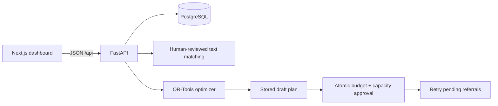

# Architecture and implementation decisions

## Purpose and boundaries

Sehat Grid coordinates **synthetic service slots**, referrals, unmet demand, and incremental funding. It is a demonstration, not a clinical decision or patient-record system. Requests use generated references and contain no names, diagnoses, contact details, or real patient data. No authentication is included in this MVP. Operator and planner controls are view modes, not security permissions; anyone with API access can perform either workflow.

## Technology choices

| Layer | Choice | Reason |
|---|---|---|
| Dashboard | Next.js App Router, TypeScript, Tailwind CSS | Typed API integration, responsive UI, straightforward Vercel deployment |
| API | Python 3.12, FastAPI, Pydantic | Validated contracts and interactive API docs; easy access to optimization libraries |
| Persistence | PostgreSQL, SQLAlchemy 2, Alembic | Transactions, conditional writes, uniqueness, and check constraints protect capacity and funding |
| Local demo | SQLite with foreign keys and WAL | Quick setup without running a database service; PostgreSQL remains the hosting target |
| Service matching | RapidFuzz alias and name similarity | Fast, explainable suggestions with explicit human review |
| Resource planning | Google OR-Tools CP-SAT | Real integer optimization with budget and demand constraints |
| Map | Interactive SVG schematic using synthetic coordinates | Matches the lightweight reference without tile credentials or an external map dependency |
| Packaging | Backend Dockerfile, Compose, pinned dependencies, GitHub Actions | Reproducible setup and a concrete deployment handoff |
| Hosting target | Vercel frontend, Railway API + PostgreSQL | Separately deployable frontend and persistent Python service |

Sentence Transformers and MapLibre were considered in the supplied planning discussion. They are **not implemented in this milestone**: pretrained embeddings add download/hosting overhead before we have an evaluation dataset, while a full geographic map adds UI complexity. RapidFuzz is text similarity, not an ML model or confidence probability. The schematic has no distance, navigation, tiles, or map zoom. Replace these behind the existing API and component boundaries when needed.

## System flow

The browser uses `NEXT_PUBLIC_API_URL`, which must be configured before the frontend build. FastAPI allows only the configured `CORS_ORIGINS`. API startup seeds empty databases after migrations. `/health` checks database connectivity. Dates come from `APP_TIMEZONE` (default Asia/Karachi); timestamps are UTC. Currency is integer PKR, avoiding floating-point money calculations.

## Data model

| Table | Key fields and relationships |
|---|---|
| `facilities` | Name + zone unique, kind, latitude, longitude |
| `services` | Canonical service name, aliases, synthetic marginal unit cost |
| `capacities` | Unique facility + service + day; total, reserved, consumed |
| `care_requests` | Generated reference, service, zone, date, priority, status, reason |
| `referrals` | Request + capacity linkage, state; cancelled history is retained |
| `budgets` | One global envelope: total and committed funding |
| `allocation_plans` | Date, allocations JSON snapshot, total cost, units, draft/approved state |

`available = total - reserved - consumed`. A completed referral consumes one slot for that date. Cancellation releases a held slot and returns the request to pending. Capacity cannot be edited below reservations plus completed care. The MVP supports one slot per request, six canonical services, and five demonstration zones. Capacity updates also register a facility's service offer for a date; a zero-total offer remains eligible for funding.

## Referral invariants

1. Request intake saves unresolved demand. It does not silently reserve a provider.
2. Recommendations require an available slot for the exact service and day. Local-zone providers rank first, then larger available capacity; other zones remain available for operator choice. There is no distance or medical appropriateness score.
3. Reservation conditionally changes a pending request to reserved and increments a capacity counter only while a slot remains. Both writes and referral creation commit together. Failure rolls everything back.
4. Confirmation accepts only reserved referrals. Completion accepts only confirmed referrals and transfers one reserved slot to consumed.
5. Cancellation accepts reserved/confirmed referrals, releases exactly one slot, retains referral history, and reopens demand. Repeat or invalid state changes return HTTP 409.

PostgreSQL rechecks the conditional update after a competing writer commits. Capacity and budget constraints are also enforced by database checks. SQLite runs the same guarded writes for the single-node demo; PostgreSQL is the concurrent deployment target.

## Intelligence and planning

Demand insights are recalculated from pending requests and **current** local capacity, rather than relying on old intake reasons. A gap is labelled no local provider, local capacity exhausted, or awaiting referral.

The optimizer considers existing facility/service/day offers in the same zone as demand. Existing local free slots are deducted from pending demand before buying more. It uses each service's synthetic marginal cost and integer quantities. Its objective prioritizes the number of urgent requests coverable, then total slots, then lower cost. The envelope is the smaller of the operator's spend limit and remaining global budget. The solver is bounded to five seconds; feasible results are accepted even if the optimum is not proven. The first facility ID with the appropriate local offer receives incremental resources in this simple model.

Approval conditionally claims a draft plan and available budget, activates capacity, and retries pending requests within one transaction. Urgent requests are retried first. A rejected approval leaves the plan and budget unchanged. Approval creates reserved referrals; partner confirmation remains a separate operator step.

Plans are stored funding proposals, not live forecasts. If demand changes after drafting, the plan's allocations remain fixed. A planner should regenerate outdated plans; funding already approved is not refunded on referral cancellation. Reprocessing may also use other existing available capacity. Resource activation assumes funding instantly creates synthetic service slots: real procurement, staffing lead times, facility maxima, availability expiration, accounting ledgers, multiple funding envelopes, and plan amendments are future work.

## API contracts

See the generated `/docs` OpenAPI UI for complete request and response details.

| Method / endpoint | Purpose |
|---|---|
| `GET /health`, `GET /api/config` | Connectivity; demo date, zones, reset availability |
| `GET /api/services`, `POST /api/services/match` | Canonical services and reviewable text suggestions |
| `GET/POST /api/facilities` | Dated directory and registration |
| `PUT /api/facilities/{id}/capacity` | `{service_id, day, total}`; atomically update dated total |
| `GET/POST /api/requests` | List requests; create with `{service_id, zone, day, priority}` |
| `GET /api/requests/{id}/recommendations` | Live available providers for a pending request |
| `POST /api/requests/{id}/reserve` | `{facility_id}`; atomically reserve one slot |
| `POST /api/referrals/{id}/confirm`, `/complete`, `/cancel` | Validated lifecycle transitions |
| `GET /api/dashboard` | Capacity, referrals, current demand gaps, global budget |
| `PUT /api/budget` | `{total}`; cannot reduce below committed funding |
| `GET/POST /api/plans` | List; optimize with `{day, limit}` |
| `POST /api/plans/{id}/approve` | Commit budget, activate capacity, retry demand |
| `GET /api/export` | JSON snapshot of selected date plus global budget |
| `POST /api/demo/reset?confirm=RESET_SYNTHETIC_DATA` | Explicit destructive reset, disabled by default |

Collection endpoints accept `?day=YYYY-MM-DD` where relevant. `GET /api/requests` and `/api/plans` without a date return all dates. Errors use FastAPI's `detail` field: 404 missing entity, 409 workflow conflict, 422 invalid input. Reservations, plan drafting, approval, and capacity editing reject past dates.

## Production follow-up

Before using real data, add authentication and authorization, auditing, data protection, and operator accountability. Further milestones include expiry of unconfirmed reservations, evaluated semantic matching and duplicate-review management, geographic routing, notification integrations, pagination, robust migration coordination when scaling replicas, and a real cost/resource catalogue. Single API replica startup migrations suit this MVP; run migrations as a dedicated deployment job before scaling.
